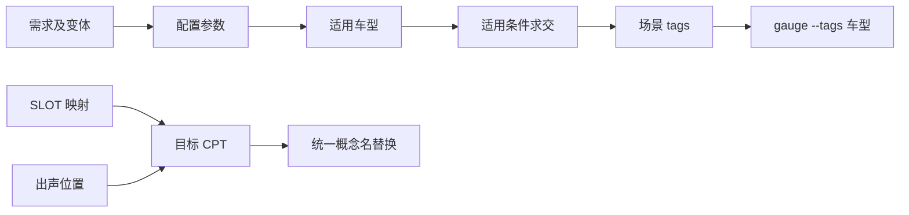

# extamp-hil-kit

External Amplifier HIL Kit 是桌面端外置功放 HIL 测试工具台。它把需求变体、配置参数、业务资产、Gauge 规格、目标 CPT 和运行环境串成一条多车型测试闭环：



输入运行车型后，应用可以自动导入需求、刷新配置、更新车型标签、重建目标 CPT、写入 `value.properties`，再执行任务、场景、规格书或测试队列。

## 文档导航

| 文档 | 类型 | 用途 |
| --- | --- | --- |
| [教程：完成首次多车型运行](docs/tutorial-first-run.md) | 教程 | 从空白项目走到第一次可验证的 Gauge 运行 |
| [一键多车型 HIL 运行指南](docs/hil-run-guide.md) | 操作指南 | 按单次任务完成资产配置、选车型和执行 |
| [用户与开发参考](docs/reference.md) | 参考 | 页面、文件格式、设置项、状态和运行参数 |
| [多车型 HIL 运行体系解释](docs/explanation.md) | 解释 | 为什么这样设计，以及各资产如何协同 |
| [项目规格书](docs/project-specification.md) | 规格 | 功能、非功能需求、验收边界和风险 |

数据契约：

- [requirements.json](docs/requirements-json.md)
- [config.json](docs/config-json.md) 与 [JSON Schema](docs/config.schema.json)
- [settings.json](docs/settings-json.md) 与 [JSON Schema](docs/settings.schema.json)

## 核心业务能力

| 入口 | 主要能力 |
| --- | --- |
| 软件需求 | Excel 导入、变体解析、参数映射开关、需求关联状态 |
| 配置参数 | 配置值关联需求变体、特殊车型规则、分层状态筛选 |
| SLOT 映射 | 映射方案总览、车型/音源筛选、按车型生成 SLOT 目标 CPT |
| 出声位置 | 场景、车型、`speak=` / `no_speak=` 关键字解析，按车型生成目标 CPT |
| 音量表 | 0–39 档位表、音源曲线、新增/编辑音量行 |
| 扬声器快照 | `snapshot.ini` 分节、通道扬声器、新增快照 |
| 规格书 | 适用条件求值、车型标签更新、目录树、新增/减少车型 |
| 封装库 | `specs/**/*.cpt` 概念树、结构化编辑 |
| 新建任务 | 场景选择、任务保存、一键配置运行 |
| 测试队列 | 任务/场景/规格书混合入队，按顺序执行 |

## 快速开始

```sh
npm install
npm run dev
```

应用启动后选择含 `manifest.json` 或 `.gauge` 的 Gauge 项目根目录。

完整运行流程见 [教程](docs/tutorial-first-run.md) 与 [操作指南](docs/hil-run-guide.md)。

## 开发命令

```sh
npm run dev         # Vite + Electron 开发
npm run type-check  # vue-tsc 类型检查
npm run build       # 构建 dist / dist-electron
npm start           # 用构建产物启动桌面应用
npm run test:unit   # Vitest 单元测试
npm run lint        # oxlint + eslint
```

## 代码结构

```text
electron/             Electron 主进程：文件读写、Gauge 执行、IPC
src/
  App.vue             壳层、项目切换、页面切换时刷新本地数据
  views/              各业务页面
  stores/             Pinia 领域状态
  composables/        项目路径、需求导入、运行资产编排
  spec/               适用条件、spec 标签、概念与目录树
  shared/             车型名归一化等跨进程共享逻辑
  models/             TypeScript 数据模型
  config/             导航与设置默认值
docs/                 规格、数据契约与用户文档
testdatas/            需求分析表回归样例
fixtures/gauge-sample/ 最小 Gauge 测试项目
```

## 关键约定

- 车型名统一归一化：删除所有空白字符，`-` 改为 `_`。
- 相对路径统一保存为 `./...`，并按项目根解析。
- 需求的「参与参数映射」状态保存在 `requirements.json` 的 `mapping` 字段。
- 读取业务数据先读需求、再读配置，避免引用状态短暂误判。
- 运行失败必须保留错误步骤、Gauge 命令、输出和退出码。

## 技术栈

Vue 3、TypeScript、Vite 8、Pinia、Vue Router、Element Plus、Tailwind CSS 4、Electron、Gauge CLI、SheetJS。
