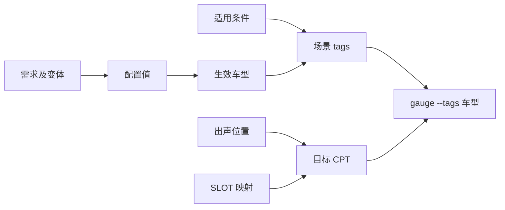

# 多车型 HIL 运行体系解释

本文解释 External Amplifier HIL Kit 为什么围绕需求变体、配置参数、车型标签和目标 CPT 组织。它是概念和设计取舍说明，不替代 [教程](tutorial-first-run.md) 与 [参考](reference.md)。

## 问题背景

外置功放 HIL 项目需要在多个车型之间复用同一套 Gauge 测试。差异资料分散在 Excel 需求、配置参数、SLOT 映射、出声位置、音量表、快照和 spec 中。人工维护会出现四类问题：

- 变体没有被任何配置值覆盖；
- 需求重新导入后旧引用失效；
- 配置参数没有及时更新；
- 适用条件写错后运行了不适用场景。

因此项目把“车型”作为贯穿资产、标签和执行的唯一选择维度。

## 核心闭环



### 需求变体

需求变体回答“哪些车型存在行为差异”。配置值不复制变体内容，只保存 `requirement_name` 和 `variant_key` 引用。需求重新导入后，引用会自动重新解析：

- 能找到：关联变体状态正常；
- 找不到：状态失效，不能静默删除；
- 需求状态汇总为正常、浮空、异常。

这样可以把“需求是否覆盖”和“配置是否更新”变成可检查状态，而不是靠人工记忆。

### 配置参数

配置值有两条车型来源：

1. 关联需求变体，得到变体车型；
2. 特殊车型规则，按前缀或包含关键字匹配需求车型。

两种来源合并得到生效车型。特殊规则命中 0 个车型仍表示已配置，因为规则意图存在；真正无配置的值是既没有关联变体也没有特殊规则的浮空值。

配置状态的优先级是 `异常 > 浮空 > 正常`。异常必须先修，不能用其他配置值的正常状态掩盖。

### 适用条件和 tags

规格书场景使用 `配置项-配置值` 引用配置车型。工具求出最终车型后写入场景 `tags`。Gauge 运行时传入 `gauge --tags <车型>`，由 Gauge 选择该车型适用的场景。

这形成多车型复用：同一套 spec 和场景可以被不同车型选择，运行前由工具重新计算而不是手工维护标签。

### 目标 CPT

出声位置和 SLOT 映射都有按车型差异。上层 spec 通过统一概念名使用这些能力。运行前按车型生成或替换目标 CPT 的内部实现：

- 出声位置目标 CPT；
- SLOT 映射目标 CPT。

目标 CPT 是具体文件路径，多个车型会按运行需要替换该文件。这样 spec 可以保持统一，执行前切换车型实现。

生成时不是给每个车型各写一份完整文件，而是把目标 CPT 当成「默认项 + 车型差异项」的合并结果：

- 源数据里不带适用车型的场景是默认项；
- 命中当前车型的场景是差异项；
- 同名标题处用差异项就地替换默认项，其余默认项与新增项保留。

合并只换内容、不改标题，所以 spec 侧的封装名始终稳定，重复标题也能收敛成一条。格式细节见 [文件格式定义](file-formats.md)。

### 一键配置运行

运行前流程固定为：

```text
导入需求
  -> 刷新配置并检查异常
  -> 更新 tags
  -> 重建出声位置目标 CPT
  -> 重建 SLOT 映射目标 CPT
  -> 写入 env/value.properties
  -> Gauge 执行
```

这个顺序的取舍是：

- 先导入需求和配置，避免用旧车型做标签；
- 再更新 tags，保证用例选择基于最新数据；
- 最后替换目标 CPT 和环境变量，保证执行上下文稳定；
- 任一步失败就停止，避免用半配置状态跑测试。

## 状态模型

| 对象 | 状态 | 含义 |
| --- | --- | --- |
| 关联变体 | 正常、失效 | 能否在需求中找到对应变体 |
| 配置值 | 正常、浮空、异常 | 配置值是否完整、是否有失效引用 |
| 配置项 | 正常、浮空、异常 | 汇总其下所有配置值 |
| 规格场景 | 无变化、待更新、不适用 | 车型标签是否需要写回 |
| 测试队列项 | 等待、运行中、成功、失败 | 执行编排状态 |

浮空不是执行失败，但它是缺失配置的信号。异常和失效必须先处理。

## 设计取舍

### 为什么标签写入 specs

Gauge 原生用 `tags` 选例。把车型写入 tags，复用 Gauge 的执行模型，不自造用例选择器。

### 为什么需求映射参与状态放进 requirements.json

参与状态与需求数据一起导入和迁移，避免浏览器本地状态与项目文件脱节。重新导入需求时保留 `mapping`，需求 ID 变化后旧状态自然失效。

### 为什么车型统一归一化

不同资产的车型可能来自 Excel 表头、文本文件或配置规则。统一删除空白并把 `-` 改成 `_`，使配置关联、CPT 生成和 `gauge --tags` 使用同一套车型标识。

### 为什么目标 CPT 是文件而不是目录

目标 CPT 是运行时替换的单个概念实现文件。一个车型运行时只需要一份有效实现，配置为文件路径最直接。

### 为什么切页重新读取本地数据

需求导入、配置修改、规格标签更新和任务保存都写入本地文件。切换页面时重新读取，避免缓存显示过期状态。

## 边界

当前体系管理测试资产和 Gauge 执行，不负责功放硬件实时控制、串口通信或测量采集。硬件在环执行结果以 Gauge CLI 和项目侧测试代码为准。
