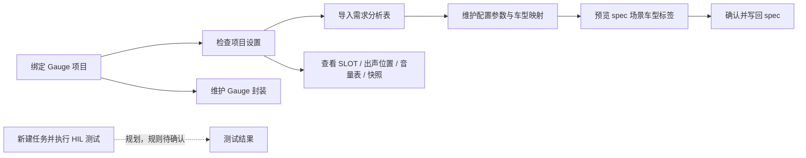
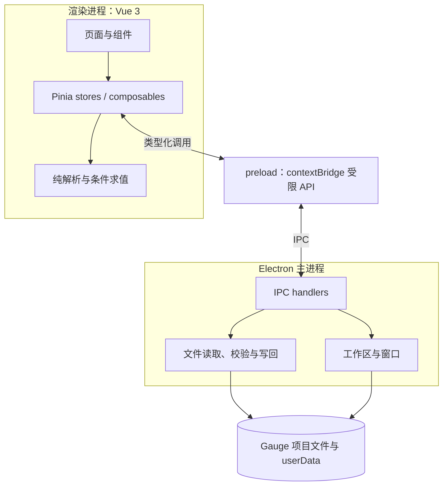
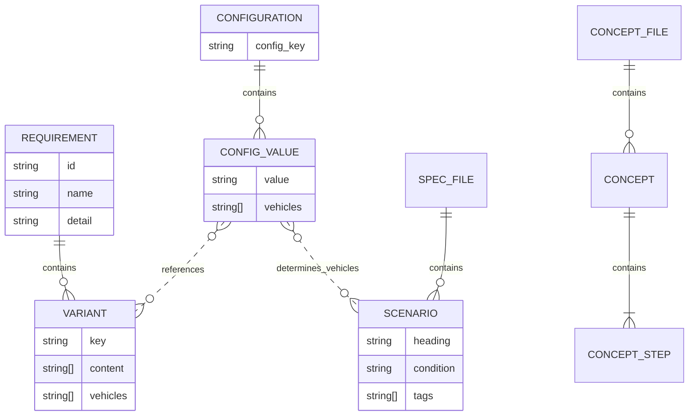

# External Amplifier HIL Kit 项目规格书

| 项目     | 内容                                             |
| -------- | ------------------------------------------------ |
| 项目名称 | extamp-hil-kit（External Amplifier HIL Kit）     |
| 项目性质 | 个人项目，仅项目所有者与大模型参与               |
| 文档版本 | V1.2                                             |
| 文档状态 | 草案，供项目所有者与大模型开展研发、测试和评审   |
| 编写日期 | 2026-11-07                                       |
| 代码基线 | `0d09cc4`，以当日工作区内容为准                  |
| 主要读者 | 项目所有者及辅助大模型                           |
| 规格范围 | 当前已实现能力，以及代码和文档中已明确的后续规划 |

## 修订记录

| 版本 | 日期       | 说明                                             |
| ---- | ---------- | ------------------------------------------------ |
| V1.0 | 2026-11-07 | 首版，建立功能、数据、接口、非功能需求与验收基线 |
| V1.1 | 2026-11-07 | 明确个人项目性质、参与方式和所有者决策职责       |
| V1.2 | 2026-11-07 | 与代码实际行为对齐：补入 R-01 / R-08 现状、关闭 R-07、补入锚定文档引用 |

> 状态说明：“已实现”表示代码基线中已存在对应实现和页面，不等同于已完成全部人工验收。“只读”表示仅支持读取、解析、搜索和展示。“规划”表示仅确认了方向，详细业务规则仍需评审。

## 1. 总则

### 1.1 编写目的

本规格书定义外置功放 HIL 工具台的目标、范围、功能行为、数据约束、进程接口、非功能要求和验收依据。项目所有者与大模型以此控制实现边界、设计测试用例并识别尚未确认的需求。

本规格书不替代各数据文件的专项契约。字段级定义以第 1.3 节列出的 Schema 和专项文档为准。

项目的核心业务闭环是：规格书与场景维护「适用条件」，配置参数通过关联需求及变体自动得到适用车型；工具把车型写入场景 tags，并调用 `gauge --tags <车型>` 只执行该车型适用的用例，从而实现多车型共用一套 spec、按车型自动选用例。配置值关联需求变体还能反向暴露未覆盖变体、需求变更、配置未正确更新和适用条件编写错误。运行前还应按所选车型自动重建出声位置目标 CPT、SLOT 映射目标 CPT并更新 tags，把多资产关联与一键配置运行合并到同一入口。

### 1.2 需求用语与状态

- “应”表示当前版本必须满足的要求。
- “不得”表示明确禁止的行为。
- “可”表示允许但不强制的行为。
- “目标”表示规划能力，不作为当前版本的完成声明。
- “TBD”表示缺少验收所需的信息，处理方式和完成时间需由项目所有者确认。

需求优先级分为：P0 为核心数据正确性与项目隔离，P1 为主要工作流和可用性，P2 为辅助效率与体验。

### 1.3 参考文件

| 文件                                                 | 用途                                   |
| ---------------------------------------------------- | -------------------------------------- |
| `README.md`                                          | 项目结构、启动流程、功能说明和开发命令 |
| `docs/requirements-json.md`                          | 需求数据落盘结构与导入语义             |
| `docs/config-json.md`、`docs/config.schema.json`     | 配置参数数据契约                       |
| `docs/settings-json.md`、`docs/settings.schema.json` | 项目设置与路径解析契约                 |
| `docs/data-model.md`                                 | 数据模型组织约定                       |
| `docs/requirements-anchor.md`                        | 需求锚定：范围、非目标、成功指标、待澄清问题 |
| `docs/grid-system.md`                                | 桌面端布局与 12 列栅格约束             |
| `package.json`                                       | 技术栈、运行环境和工程命令             |

### 1.4 术语

| 术语                  | 定义                                                       |
| --------------------- | ---------------------------------------------------------- |
| HIL                   | Hardware-in-the-Loop，硬件在环测试                         |
| Gauge 项目            | 含 `manifest.json` 或 `.gauge` 标记的测试项目目录          |
| 需求变体              | 同一需求在不同车型上的差异描述及其适用车型集合             |
| 配置项                | `config_key` 标识的一组配置值，例如“扬声器配置”            |
| 配置值                | 配置项下的一个取值，可关联需求变体和手工车型               |
| 生效车型              | 配置值关联变体的车型与手工车型的去重并集                   |
| 规格 / spec           | Gauge 的 `.spec` 测试规格文件                              |
| 封装 / 概念 / concept | Gauge 的 `.cpt` 可复用步骤封装                             |
| 车型全集              | 当前配置参数数据可解析出的车型集合，用于条件求值和“非”运算 |
| DIP                   | 设备无关像素，窗口与布局使用的逻辑像素                     |

## 2. 项目概述

### 2.1 背景与目标

外置功放微型 HIL 项目需要同时维护需求、车型差异、配置参数、Gauge 规格、步骤封装及多类业务数据。本项目提供本地桌面工具台，减少手工整理 Excel、跨文件查找和场景标签维护的工作量。

当前版本的核心目标是：

1. 以 Gauge 项目为数据边界，避免不同项目的数据混用。
2. 将需求分析表转换为结构化需求与变体数据。
3. 维护配置参数及其车型映射，并显式暴露失效或歧义引用。
4. 根据配置参数计算 Gauge 场景适用车型，预览后更新场景标签。
5. 集中查看 SLOT 映射、出声位置、音量表和扬声器快照。
6. 结构化维护 Gauge 封装文件，并在保存前检查格式问题。

### 2.2 参与方式与职责

| 参与方     | 职责与决策边界                                                                               |
| ---------- | -------------------------------------------------------------------------------------------- |
| 项目所有者 | 唯一用户和最终责任人；提出需求，审查代码与文档，决定提交和发布，执行或确认验收               |
| 大模型     | 辅助需求分析、设计、编码、测试和文档编写；输出由项目所有者审查，不作为独立责任人或项目决策方 |

本项目没有外部团队成员、客户代表或独立测试、验收角色。文档中的研发、测试、评审和验收活动均由项目所有者在大模型辅助下完成，不表示存在额外参与者。

大模型可以通过多个会话参与同一工作区，但这不改变个人项目性质，也不形成多用户、账户权限或协同编辑需求。多会话同时修改文件时仍需遵守第 15 章的本地并发协调要求。

### 2.3 范围与完成状态

| 模块                   | 当前范围                                          | 状态               |
| ---------------------- | ------------------------------------------------- | ------------------ |
| 工作区与应用壳层       | Gauge 项目绑定、最近项目、窗口、主题、三栏布局    | 已实现             |
| 新建任务               | 导航和占位页                                      | 规划，详细需求 TBD |
| 配置参数               | 配置项/配置值维护、变体引用、手工车型、搜索、落盘 | 已实现             |
| SLOT 映射              | 目录读取、总览矩阵、方案详情、异常提示          | 已实现，只读       |
| 出声位置               | 读取场景、车型、步骤、扬声器，搜索                | 已实现，只读       |
| 音量表                 | 读取车型 × 音源 × 音量档位表，搜索                | 已实现，只读       |
| 快照                   | 读取快照目录和通道映射，搜索                      | 已实现，只读       |
| 规格                   | 条件求值、车型标签预览、写回 `.spec`              | 已实现             |
| 封装管理               | `.cpt` 列表、搜索、新增、编辑、删除、校验         | 已实现             |
| 需求                   | Excel 选择、探测、解析预览、保存、读回、搜索      | 已实现             |
| 项目设置               | 数据路径与导入默认参数的按项目维护                | 已实现             |
| HIL 硬件控制与测试执行 | 当前代码基线未定义                                | 不在当前验收范围   |

### 2.4 当前业务主流程

“规格”与“封装管理”修改 Gauge 项目源码。四个业务查看器只读取资料，不代表已经具备播放、采集、实时监测或硬件执行能力。

## 3. 系统总体要求

### 3.1 系统架构

渲染进程不得直接访问 Node 文件系统。主进程负责工作区、系统对话框和文件读写；纯解析逻辑尽可能保持为可单测函数；跨进程共享类型使用相对路径和 `import type`。

### 3.2 技术约束

| 类别     | 要求                                                                          |
| -------- | ----------------------------------------------------------------------------- |
| 前端     | Vue 3、TypeScript、Vite 8、Pinia、Vue Router                                  |
| UI       | Element Plus 按需导入、Tailwind CSS 4 CSS-first 配置                          |
| 桌面壳   | Electron，`contextIsolation: true`、`nodeIntegration: false`、`sandbox: true` |
| Excel    | SheetJS；主进程读取字节后调用 `XLSX.read(buffer)`                             |
| Node     | `^22.18.0` 或 `>=24.12.0`                                                     |
| 部署形态 | 本地桌面应用；生产环境通过 `file://` 加载渲染产物                             |
| 适配边界 | 桌面端专属，不做移动端和平板适配                                              |

## 4. 功能需求

### 4.1 工作区与项目管理

| 编号      | 优先级 | 需求                                                           | 验收条件                                                                        |
| --------- | ------ | -------------------------------------------------------------- | ------------------------------------------------------------------------------- |
| FR-WS-001 | P0     | 未绑定有效项目时，应用应停留在启动页，不渲染三栏业务界面。     | 清除当前项目后启动，仅显示标题栏和项目选择界面；不能进入业务数据页。            |
| FR-WS-002 | P0     | 选择目录时应验证 Gauge 项目标记。                              | 含 `manifest.json` 或 `.gauge` 的目录可绑定；其他目录显示错误且保持未绑定状态。 |
| FR-WS-003 | P1     | 绑定成功后应持久化当前项目，并维护最近项目列表。               | 重启后可恢复当前项目；路径归一化后不产生重复项；最近项目最多 5 个。             |
| FR-WS-004 | P0     | 读取工作区时应过滤失效路径。                                   | 删除或移动项目目录后，历史失效项不再出现；当前项目失效时回到启动页。            |
| FR-WS-005 | P0     | 切换或解绑项目时，应清理上一项目的内存数据并按新项目重新加载。 | 切换后需求、配置、规格、封装和业务查看器不显示上一项目内容。                    |
| FR-WS-006 | P1     | 标题栏和侧栏应显示当前项目，并提供切换入口。                   | 绑定后可见项目名；点击“切换”可回到启动页重新选择。                              |

### 4.2 应用壳层与通用界面

| 编号      | 优先级 | 需求                                                               | 验收条件                                                                   |
| --------- | ------ | ------------------------------------------------------------------ | -------------------------------------------------------------------------- |
| FR-UI-001 | P1     | 应用应采用无边框单实例窗口，提供最小化、最大化/还原和关闭功能。    | 各按钮行为正确；最大化图标随状态变化；重复启动聚焦已有窗口而非新建实例。   |
| FR-UI-002 | P1     | 默认窗口应为 1176 × 768 DIP，最小为 1120 × 720 DIP。               | 默认和最小尺寸符合约束；最小尺寸下主要区域可用且无页面级横向溢出。         |
| FR-UI-003 | P1     | 三栏区域应支持拖拽调整与收起/展开，比例符合 `左 3 · 中 5 · 右 4`；左栏与面板默认展开，右栏默认收起。 | 拖动在既定上下限内生效；收起后主内容填充剩余空间；任一区域收展不改变其他区域宽度（左右栏宽度互不牵动）；窗口缩放后布局比例稳定。 |
| FR-UI-004 | P1     | 主题应支持跟随系统、浅色和深色，并持久化选择。                     | 三种模式切换正确；重启后保持选择；首屏无不一致主题闪烁。                   |
| FR-UI-005 | P2     | 设计网格应可通过标题栏或 `Ctrl + Shift + G` 开关。                 | 默认关闭；开启后显示 12 列 × 48 行网格；网格不拦截鼠标操作。               |
| FR-UI-006 | P1     | 生产环境 `file://` 下路由应可用。                                  | 构建后启动应用，各导航页可进入，刷新或直接切换路由不出现路径错误。         |

### 4.3 需求导入与查看

| 编号       | 优先级 | 需求                                                       | 验收条件                                                                                                      |
| ---------- | ------ | ---------------------------------------------------------- | ------------------------------------------------------------------------------------------------------------- |
| FR-REQ-001 | P1     | 应支持选择 `.xlsx`、`.xlsm`、`.xls` 文件并读取工作表列表。 | 合法文件返回工作表；取消选择不产生错误；无法读取时显示原因，不修改已保存数据。                                |
| FR-REQ-002 | P1     | 应支持工作表、表头行和列映射的自动探测与人工调整。         | 默认优先选择名称含“需求”的工作表；可在前 30 行识别同时含需求 ID 和名称的表头；设置中的显式值优先于探测值。    |
| FR-REQ-003 | P0     | 需求行应按需求 ID、名称、详情和车型单元格解析。            | 缺少需求 ID 的行跳过并告警；重复 ID 合并为同一需求；原始详情保留换行；ID 与名称导入时去除所有空白字符。       |
| FR-REQ-004 | P0     | 车型单元格语义应统一。                                     | `●` 表示适用且无差异；`●` 后文本构成变体描述；`—` 表示不适用；空白表示未填写；平台列整列忽略。                |
| FR-REQ-005 | P0     | 变体应按规范化内容键合并，并保留原始写法。                 | NFKC 归一并去除控制字符、空白和标点后相同的描述合并；`content` 保留去重后的原始写法，`vehicles` 合并且去重。  |
| FR-REQ-006 | P0     | 车型表头应支持拆分和归一化。                               | 按 `/`、`、`、`,`、`，`、`;`、`；` 拆分；去引号和空白，`_` 转为 `-`；单个空表头跳过，连续两个空表头停止扫描。 |
| FR-REQ-007 | P1     | 保存前应展示解析预览、统计、跳过情况和逐行告警。           | 预览中的需求数、变体数、车型数与解析结果一致；用户可核对详情后决定导入。                                      |
| FR-REQ-008 | P0     | 导入应整体替换当前项目的需求数据，并保留首次创建时间。     | 首次保存生成 `createdAt`；再次导入保持 `createdAt`、刷新 `updatedAt`、整体替换 `requirements`。               |
| FR-REQ-009 | P0     | 应用启动和切换项目时应自动读回需求数据。                   | 有效文件直接展示；缺失文件显示空状态；损坏、结构错误或版本不支持时提示重新导入，不展示半份数据。              |
| FR-REQ-010 | P1     | 需求页应支持统计、筛选和展开详情。                         | 可按需求名称文本、车型单选、需求关联状态多选与变体关联状态单选过滤；变体筛选同步作用于展开明细；展开后 ID 位于详情上方，详情完整展示不滚动。 |
| FR-REQ-011 | P1     | 关闭导入弹窗后的状态保留应符合约定。                       | 关闭后清除预览和成功提示，但保留文件与列映射，便于下次继续；导入成功后页面自动刷新。                          |
| FR-REQ-012 | P1     | 需求页应展示配置关联状态并支持参数映射开关。               | 首层依次为需求名称、变体数量、关联状态、映射；映射选项为参与/不参与，不参与时状态固定为正常；参与状态持久化到 requirements.json 的 mapping 字段，重新导入时保留。展开可见各变体内容、适用车型及是否已关联。 |
| FR-REQ-013 | P1     | 关联状态应由配置值对当前需求变体的引用计算。               | 全部未关联且无失效引用为未关联；部分当前变体未关联为变体增加；存在已失效变体引用为变体删除；增删同时存在为变体变更；全部当前变体已关联且无失效引用为正常。需求整体缺失的引用在页面顶部单独提醒。 |

### 4.4 配置参数维护

| 编号       | 优先级 | 需求                                                      | 验收条件                                                                                   |
| ---------- | ------ | --------------------------------------------------------- | ------------------------------------------------------------------------------------------ |
| FR-CFG-001 | P0     | 配置项名称应在全项目唯一，配置值在所属配置项内唯一。      | 新增或重命名造成重复时拒绝保存并提示；合法重命名同步更新配置值归属。                       |
| FR-CFG-002 | P0     | 应支持配置项和配置值的新增、编辑、删除及分层筛选。      | 配置键、车型、配置项状态、配置值状态、关联变体状态均为单选；项/值状态为正常、浮空、异常，变体状态为正常、失效；筛选框完整显示占位文案。 |
| FR-CFG-003 | P0     | 配置值应可引用“需求 → 变体”，引用仅保存需求名称和变体键。 | 新增引用来自当前需求数据；文件中不出现变体内容或车型快照；重复引用在写入前去重。           |
| FR-CFG-004 | P0     | 配置值应支持特殊车型规则，并计算生效车型。                | 规则只有「以…开头」「包含…」两种；生效车型等于变体解析车型与规则命中需求车型的去重并集；派生车型不落盘。 |
| FR-CFG-005 | P0     | 配置状态应按引用与特殊车型配置计算。                    | 变体找不到或无法唯一确定均为失效；值无关联且无特殊配置为浮空，存在失效引用为异常，其余正常；项无值为浮空，并按异常 > 浮空 > 正常汇总。特殊规则命中 0 仍算已配置。 |
| FR-CFG-006 | P0     | 配置保存应经过主进程校验和归一化。                        | 非法结构、重复主键或重复配置值不写入；名称去首尾空白，车型与引用去重；错误返回页面。       |
| FR-CFG-007 | P0     | 配置数据应自动读回并按编辑器模型整份保存。                | 启动和切换项目时读回；首次保存生成 `createdAt`，后续保持该字段并刷新 `updatedAt`。         |
| FR-CFG-008 | P0     | 需求变化后，配置引用和规格预览应使用最新需求重新计算。    | 重新导入需求后，有效引用车型随之更新，失效引用和“待处理”统计同步变化。                     |

### 4.5 项目设置

| 编号       | 优先级 | 需求                                                               | 验收条件                                                                                                 |
| ---------- | ------ | ------------------------------------------------------------------ | -------------------------------------------------------------------------------------------------------- |
| FR-SET-001 | P0     | 设置应按项目保存到 `.hil-kit/settings.json`，不得跨项目复用。      | 两个项目分别设置不同路径后，切换项目时各自显示自己的设置。                                               |
| FR-SET-002 | P0     | 应支持业务文件路径、cpt 生成目标文件和 Gauge 运行参数设置。 | 快照、CPT、SLOT CPT 均指向具体文件；Gauge 可执行文件留空用 PATH；环境名用于写入 value.properties；附加参数按独立 argv 插入 gauge run 后，场景名不经 shell 拼接。 |
| FR-SET-003 | P1     | 需求与配置路径为空时应使用默认位置，其他业务路径为空时表示未配置。 | 空的需求/配置路径落到 `.hil-kit` 默认文件；空的业务路径在对应页面显示配置指引。                          |
| FR-SET-004 | P1     | 应支持需求导入默认文件、工作表、表头行和列位置。                   | 下次导入时使用已保存默认值；空串或 0 触发自动探测；显式列配置覆盖探测结果。                              |
| FR-SET-005 | P0     | 设置保存前应校验路径文本、表头行和列字母。                         | 路径去首尾空白；列号统一为 1 至 3 个大写字母；表头行为不小于 0 的整数；非法值不写文件。                  |
| FR-SET-006 | P0     | 设置文件不可用时仍应返回默认设置，并区分尚未创建与文件损坏。       | 文件缺失时返回默认值且不提示错误；文件损坏、结构错误或版本不支持时返回默认值并显示错误，不读取部分设置。 |
| FR-SET-007 | P0     | 设置保存后，依赖这些路径的数据应按新设置重新读取。                 | 修改需求、配置或业务数据路径并保存后，对应页面展示新位置的数据，不继续沿用旧缓存。                       |

### 4.6 SLOT 映射查看

| 编号        | 优先级 | 需求                                                                 | 验收条件                                                                                           |
| ----------- | ------ | -------------------------------------------------------------------- | -------------------------------------------------------------------------------------------------- |
| FR-SLOT-001 | P1     | 应读取 SLOT 映射目录下的全部 `.txt` 文件。 | 每个文件为一种映射，文件名作为映射名称；首行 `适用车型:` 按 `/`、逗号等拆分；`#` 为音源，步骤中的 `SLOT数字` 为通道。 |
| FR-SLOT-002 | P1     | 应提供总览矩阵与详情视图。 | 总览首列为音源类型、后续各列为映射文件名称；连续 SLOT 用 `-` 连接，非连续用 `、` 分隔；详情左侧映射列表，右侧依次展示适用车型与各音源 SLOT。 |
| FR-SLOT-003 | P0     | 映射目录或文件异常应可识别。 | 未配置时显示目录设置指引；目录缺失显示空数据；单文件读取失败显示方案级警告，不影响其他文件；无 SLOT 或 sleep 占位的单元格显示 `-`。 |
| FR-SLOT-004 | P2     | 动态矩阵与详情应保持可读并支持车型与音源筛选。 | 映射列随文件数量增减，名称不显示 `.txt` 后缀；车型与音源类型单选同步过滤总览和详情；详情适用车型独立一行；超出时表格内部横向滚动。 |
| FR-SLOT-005 | P1     | 应支持按当前车型替换 SLOT映射目标 CPT。 | 汇总该车型适用映射方案写入设置中的目标 CPT，保留原始步骤；上层 spec 通过统一概念名替换实现；生成后刷新封装库。 |

### 4.7 出声位置查看

| 编号       | 优先级 | 需求                                             | 验收条件                                                                                                     |
| ---------- | ------ | ------------------------------------------------ | ------------------------------------------------------------------------------------------------------------ |
| FR-OUT-001 | P1     | 应解析场景、车型、步骤及两类扬声器关键字。 | 未写适用车型表示全部车型，多个车型用 `/`；只识别步骤行中 `speak=` / `no_speak=` 后单双引号内容，多个关键字按 `|` 分隔；其他竖线写法按普通步骤保留。 |
| FR-OUT-002 | P1     | 应分场景展示车型、步骤和扬声器关键字。     | 标题下显示适用车型且单行省略；底部依次显示出声、不出声扬声器关键字并支持换行，无内容显示 `-`。 |
| FR-OUT-003 | P2     | 应支持场景文本与车型单选筛选。             | 场景按标题文本过滤，车型为单选下拉；全部车型场景匹配任意车型，无结果有空状态。 |
| FR-OUT-004 | P0     | 未配置、文件缺失和读取失败应区别处理。           | 分别显示设置指引、空状态和错误信息，不将异常数据展示为有效场景。                                             |
| FR-OUT-005 | P1     | 应支持按当前车型替换出声位置目标 CPT。 | 选择车型后生成并写入设置中的目标 CPT；上层 spec 用统一概念名，通过替换概念内部实现适配不同车型；生成后刷新封装库。 |

### 4.8 音量表查看

| 编号         | 优先级 | 需求                                                        | 验收条件                                                                          |
| ------------ | ------ | ----------------------------------------------------------- | --------------------------------------------------------------------------------- |
| FR-METER-001 | P0     | 当前版本应解析 UTF-8 文本音量表，首行为表头，其余为数据行。 | 能识别“车型”“音源”列，其余列作为音量档位；缺失表头列时按既有回退位置读取。        |
| FR-METER-002 | P1     | 应自动识别分号、逗号或 Tab 分隔符。                         | 按表头中出现次数最多的候选分隔符切分；去除单元格首尾空白和成对引号。              |
| FR-METER-003 | P1     | 应展示车型 × 音源类型 × 0–39 音量档位，并支持单选筛选。 | 音源类型与车型均为单选下拉并同时作用于表格和曲线；空 dB 显示 `-`，表头使用“音源类型”，不显示标题统计。 |
| FR-METER-004 | P0     | 未配置、文件缺失和解析失败应区别处理。                      | 分别显示设置指引、空状态和错误信息；不得把二进制 Excel 当作已成功解析的文本数据。 |
| FR-METER-005 | P1     | 应提供按音源分组的音量曲线视图。 | 每种音源一个图表，X 为 0–39 音量、Y 为 dB；相同数值的车型曲线合并，空档位断开不连线。 |
| FR-METER-006 | P1     | 应支持新增和编辑音量行并整份写回。 | 车型与音源必填，dB 为数字或留空；重复车型+音源拒绝；写回沿用原分隔符，保存后表格与曲线刷新。 |

当前限制：解析器不是通用 RFC 4180 CSV 解析器，不支持含内嵌分隔符、换行等复杂引号语义（`electron/business-store.ts` 的 `splitCells` 只去掉首尾空白与成对引号）。文件选择器允许 `.csv`/`.xlsx`/`.xls`（`electron/settings.ts` 的 `PICK_FILTERS['volume-table']`），读取实现却是 `readFileSync(target, 'utf8')` 后按文本切分，选到 Excel 会把二进制当文本解析出错误的行。该不一致为 R-01，须先决策再改实现。

### 4.9 扬声器快照查看

| 编号        | 优先级 | 需求                                                 | 验收条件                                                                                   |
| ----------- | ------ | ---------------------------------------------------- | ------------------------------------------------------------------------------------------ |
| FR-SNAP-001 | P1     | 应读取快照目录下统一的 `snapshot.ini`。 | 目录或文件缺失按空数据处理；每个 `[适用车型]` 分节作为一组快照，分节名为左侧快照名称。 |
| FR-SNAP-002 | P1     | 应解析车型与通道扬声器对应关系。 | 分节名按 `/` 等分隔为适用车型；扬声器按非空行从通道 1 递增，跳过空白行；兼容 `通道N对应扬声器` 写法。 |
| FR-SNAP-003 | P2     | 应采用左右分栏并支持车型筛选。 | 左侧为快照名称列表，车型单选同步过滤；右侧逐行显示通道与扬声器名称；未配置和读取失败有各自提示。 |
| FR-SNAP-004 | P1     | 应支持新增快照分节并写回 snapshot.ini。 | 适用车型作为分节名，逐行扬声器从通道 1 递增；保留原文件，拒绝同名分节与空输入，保存后自动读回。 |

### 4.10 规格条件求值与标签更新

| 编号        | 优先级 | 需求                                                                                    | 验收条件                                                                                                                     |
| ----------- | ------ | --------------------------------------------------------------------------------------- | ---------------------------------------------------------------------------------------------------------------------------- |
| FR-SPEC-001 | P0     | 应递归读取项目 `specs` 下的 `.spec` 文件，并识别 Gauge 标题、场景、标签和 `适用条件:`。 | 支持 ATX 与下划线式标题；首个场景前的条件作用于整份规格，之后作用于场景；多行标签可合并解析。                                |
| FR-SPEC-002 | P0     | 条件引用 `配置项-配置值` 应解析为该配置值的生效车型集合。                               | 已知引用返回正确车型；未知引用返回空集合并产生警告，不当作全量车型。                                                         |
| FR-SPEC-003 | P0     | 条件表达式应支持集合布尔运算。                                                          | `&` 和 `&&` 为交集，单竖线和双竖线为并集，`!` 和 `~` 为相对车型全集的补集，括号改变优先级；优先级为 `!` > `&` > 并集运算符。 |
| FR-SPEC-004 | P0     | 空条件、保留字和最终条件应符合约定。                                                    | 空条件返回车型全集；“预留”“不适用”返回空集合；场景最终车型为规格书条件与场景条件的交集。                                     |
| FR-SPEC-005 | P0     | 条件语法错误应安全失败。                                                                | 无法解析时该条件按空集合处理并显示警告，不得静默放行全部车型。                                                               |
| FR-SPEC-006 | P1     | 写回前应以目录树和车型差异展示场景变化。 | 左侧根节点为规格书并支持一键折叠全部目录；目录与文件提供级联 checkbox，父级全选/清空后代，部分选中显示半选；忽略空目录且文件不带后缀；右侧显示新增/减少车型（`/` 分隔、溢出省略）；状态仅无变化、待更新、不适用；警告区与表格右缘对齐。 |
| FR-SPEC-007 | P0     | 标签写回应仅重写场景标签块，保留用户标签、适用条件和正文。                              | 已知旧车型标签与“不适用”被替换，其他标签保留；无车型时写“不适用”；无标签时插入；多段标签合并；行尾风格保持。                 |
| FR-SPEC-008 | P0     | 标签更新应由用户显式触发，并具备幂等性。                                                | 配置变化只更新预览，不自动写文件；点击后仅写变化文件；重复执行第二次无新增变化。                                             |
| FR-SPEC-009 | P0     | spec 读写路径必须限制在当前项目 `specs` 目录内。                                        | 目录外绝对路径或逃逸相对路径被拒绝；成功写回后重新读取并刷新页面。                                                           |

当前限制：多文件更新按顺序执行，不提供跨文件事务。中途失败时，此前已写入的文件不会自动回滚，见第 15 章风险项。

### 4.11 Gauge 封装库

| 编号       | 优先级 | 需求                                                                           | 验收条件                                                                                                                |
| ---------- | ------ | ------------------------------------------------------------------------------ | ----------------------------------------------------------------------------------------------------------------------- |
| FR-CPT-001 | P1     | 应递归列出项目 `specs` 下的 `.cpt` 文件，并以概念树展示。 | 左侧根节点为概念，忽略无 cpt 的空目录；右侧为选中文件详情；概念文本筛选只匹配封装标题，标题统计不显示。 |
| FR-CPT-002 | P0     | 应识别 Gauge 封装结构并报告格式问题。                                          | 标题使用单个 `#`，步骤使用 `*`，表格挂在步骤下；场景标题、孤立步骤/表格、空标题、参数括号或引号不配对等均产生问题提示。 |
| FR-CPT-003 | P0     | 每个封装至少包含一步，标题动态参数使用 `<参数名>`。                            | 空封装不能保存；标题中的静态值、特殊参数或不配对括号被校验；同文件重复标题被拒绝。                                      |
| FR-CPT-004 | P0     | 应支持新建、编辑和删除封装，以及向指定文件添加封装。                           | 保存后重新生成目标 `.cpt` 并刷新列表；跨文件重复标题显式告警；非法表格列数不得保存。                                    |
| FR-CPT-005 | P1     | 删除操作应确认，并明确删除最后一个封装的后果。                                 | 删除文件需确认；删除文件内最后一个封装时提示将同时删除文件；取消不产生修改。                                            |
| FR-CPT-006 | P0     | `.cpt` 读写和删除路径必须限制在当前项目 `specs` 目录内。                       | 目录外路径或路径逃逸被拒绝；写入成功后重新读取，失败返回可见错误。                                                      |

当前限制：结构化保存会重新生成整个 `.cpt` 文件，不保留概念内部注释和原始排版。内联表格保存为表头与数据行，不保留 `|---|` 分隔行。

### 4.12 已明确规划与占位边界

| 编号        | 方向       | 当前可确认内容                                                       | 验收前置条件                                                        |
| ----------- | ---------- | -------------------------------------------------------------------- | ------------------------------------------------------------------- |
| FR-PLAN-001 | 新建任务   | 已支持按 spec 选择具体场景、保存任务并调用 Gauge 单独运行 | 任务保存到 `.hil-kit/tasks.json`；运行输出、错误和退出码显示在底部终端；路径限制在 specs 内 |
| FR-PLAN-002 | 测试工作流 | 导航注释表达了“参数设置 → 播放定位/电平 → 快照 → 规格”的使用顺序设想 | 不据此推定硬件控制、实时采集或串口能力；当前仅明确支持 Gauge CLI 场景执行 |
| FR-PLAN-003 | 测试队列   | 任务、场景和整份规格书可入队并按顺序执行 | 当前会话内维护队列；执行中可继续入队；状态含等待、运行中、成功、失败；支持待执行项排序、移除和查看各项输出 |
| FR-PLAN-004 | 直接运行   | 任务、选中场景和整份规格书可直接运行 | 新建任务页区分“运行任务”（先保存）与“仅运行场景”；可选择运行车型并作为 `--tags`；规格书页可运行整份或单场景；输出统一进入底部终端 |
| FR-PLAN-005 | 核心闭环   | 适用条件与车型标签驱动 Gauge 自动选用例 | 配置值经需求变体得到车型，场景 tags 更新为车型标签；运行车型以 `gauge --tags` 传入；需求/配置/条件异常在对应页面暴露 |
| FR-PLAN-006 | 一键配置运行 | 指定车型后自动导入需求、刷新配置、更新 tags、重建 CPT、写入 env 再执行 | 配置了需求分析表时先导入并刷新配置，配置异常阻断运行；随后更新 tags、生成两类目标 CPT；Gauge 执行前把 vehicle_model 写入 env/&lt;环境&gt;/value.properties；任一步失败则中止该次运行并显示步骤。 |

左侧任务/工程分组、右侧快捷入口和插件目前仍是界面占位，不纳入当前版本验收。底部终端已用于展示 Gauge 执行输出。

## 5. 数据需求

### 5.1 数据位置与所有权

| 数据       | 默认位置                            | 写入方     | 说明                                        |
| ---------- | ----------------------------------- | ---------- | ------------------------------------------- |
| 工作区     | Electron `userData/workspace.json`  | 工作区模块 | 当前项目与最多 5 个最近项目，属于应用级数据 |
| 项目设置   | `<项目>/.hil-kit/settings.json`     | 项目设置页 | 按项目保存，路径与导入默认参数              |
| 需求       | `<项目>/.hil-kit/requirements.json` | 需求导入   | 可通过设置改变位置；导入时整体替换需求数组  |
| 配置参数   | `<项目>/.hil-kit/config.json`       | 配置参数页 | 可通过设置改变位置；编辑后整份写回          |
| Gauge 规格 | `<项目>/specs/**/*.spec`            | 规格页     | 仅写回有变化的场景标签                      |
| Gauge 封装 | `<项目>/concepts/**/*.cpt`          | 封装管理页 | 结构化生成整份文件，可删除文件              |
| SLOT 映射  | 项目设置指定                        | 外部维护   | 工具只读映射及其引用的 slot 文件            |
| 出声位置   | 项目设置指定                        | 外部维护   | 工具只读                                    |
| 音量表     | 项目设置指定                        | 外部维护   | 工具只读 UTF-8 文本                         |
| 扬声器快照 | 项目设置指定目录                    | 外部维护   | 工具只读目录下的 txt 文件                   |

### 5.2 通用数据约束

1. `requirements.json`、`config.json` 和 `settings.json` 的当前 `schemaVersion` 均为 `1`。读取方应拒绝不支持的结构版本。
2. `createdAt`、`updatedAt` 使用 ISO 8601 UTC 时间。`createdAt` 只在首次创建时生成，后续保存保持不变；设置文档只使用 `updatedAt`。
3. JSON 文件按 UTF-8 读写。业务文本解析应去除开头 BOM，统一处理 CRLF/LF。
4. 派生数据不落盘，包括车型全集、配置值生效车型、导入统计和解析后的绝对路径。
5. 需求变体的 `key` 是规范化内容键，不是“变体 N”的编号引用。空字符串是“无变体差异”分支的合法键。
6. 配置值在内存中使用 `config_key + value` 定位，但落盘的配置值对象不重复保存 `config_key`。
7. 车型名称在需求导入时按统一规则归一化。手工车型只执行已定义的 trim 等处理，不进行额外猜测。

### 5.3 核心实体关系

配置值与变体之间通过 `(requirement_name, variant_key)` 逻辑关联，不是数据库外键。需求重导入后必须重新解析该关联。

### 5.4 数据完整性与变更边界

- 需求、配置和设置保存前必须在主进程完成结构与业务约束校验，校验失败不得写入。
- spec 与 concept 主进程接口必须拒绝目标目录之外的读写或删除。
- 配置引用失效不得导致整份配置不可保存；格式损坏则不得被当作有效文档读取。
- 当前版本未提供自动备份、撤销、跨文件事务或并发编辑冲突解决。外部程序同时修改同一文件时，后写内容可能覆盖先写内容。
- 规格批量更新与封装整份重写属于有损操作边界，验收必须检查非目标内容和失败后的文件状态。

字段级约束以各专项数据文档为准。本规格书与专项文档冲突时，先确认实际代码行为，再评审并同步修订，不得静默选择一种解释。

## 6. 接口需求

### 6.1 渲染进程接口边界

渲染进程仅通过 `window.desktop` 使用 preload 暴露的能力，不得直接引入 Node、Electron 主进程模块或文件系统 API。IPC 返回结构化的成功、空数据、未配置或错误结果，业务错误应转换为可见状态。

| API 组         | IPC 通道                                                                           | 用途                       |
| -------------- | ---------------------------------------------------------------------------------- | -------------------------- |
| `window`       | `window:minimize`、`window:toggle-maximize`、`window:close`、`window:is-maximized` | 窗口控制                   |
| 窗口事件       | `window:maximized-change`                                                          | 向渲染层同步最大化状态     |
| `workspace`    | `workspace:current`、`workspace:choose`、`workspace:open`、`workspace:clear`       | 项目读取、选择、打开与解绑 |
| `requirements` | `requirements:load/choose/probe/preview/save`                                      | 需求读回与 Excel 导入流程  |
| `configs`      | `configs:load`、`configs:save`                                                     | 配置读取与整份保存         |
| `output`       | `output:load`                                                                      | 出声位置读取               |
| `meter`        | `meter:load`                                                                       | 音量表读取                 |
| `slotMap`      | `slot-map:load`                                                                    | SLOT 映射读取              |
| `snapshot`     | `snapshot:load`                                                                    | 快照目录读取               |
| `specs`        | `specs:list`、`specs:read`、`specs:write`                                          | spec 清单、读取和写回      |
| `concepts`     | `concepts:list`、`concepts:read`、`concepts:write`、`concepts:delete`              | cpt 清单、读取、写回和删除 |
| `settings`     | `settings:load`、`settings:save`、`settings:pick-file`、`settings:pick-directory`  | 设置读写与系统路径选择     |

preload 还暴露 `platform` 和 Electron/Chrome/Node 版本信息。新增 IPC 时必须同步更新主进程注册、preload、渲染层类型声明和对应测试。

### 6.2 外部文件格式

| 格式         | 当前支持边界                                                                          |
| ------------ | ------------------------------------------------------------------------------------- |
| 需求 Excel   | `.xlsx`、`.xlsm`、`.xls`；SheetJS 从字节读取，不使用 ESM 下不可依赖的 `XLSX.readFile` |
| JSON         | 需求、配置和设置使用既定 Schema；多余字段和不支持版本按契约拒绝                       |
| spec         | Gauge `.spec`，另支持项目扩展指令 `适用条件:`                                         |
| concept      | Gauge `.cpt`，包含封装标题、步骤和步骤内联表格                                        |
| SLOT mapping | 目录下每个 `.txt` 为一种映射；首行适用车型，`#` 音源场景，步骤内 `SLOT数字` 为通道 |
| 出声位置     | 自定义文本结构，见 FR-OUT-001                                                         |
| 音量表       | UTF-8 分隔文本，分号、逗号或 Tab；不等同于完整 CSV 或 Excel 支持                      |
| 快照         | `snapshot.ini` 的 `[适用车型]` 分节，扬声器按非空行从通道 1 递增                  |

## 7. 界面与交互要求

1. 所有页面和组件的水平布局应遵循 `docs/grid-system.md`。除文档明确的外壳三栏例外，比例布局使用 Tailwind 12 列栅格。
2. 不写移动端断点。最小窗口下，文本截断、表格滚动和内部区域滚动不得导致整个应用横向溢出。
3. 左栏、右栏和下面板的拖拽范围由统一布局状态控制，不允许各组件自行维护冲突尺寸。
4. Element Plus 负责组件视觉和主题，Tailwind 负责布局与间距。深浅色均由 `html.dark` 统一驱动。
5. 窗口与布局使用 DIP。不得用自定义页面缩放补偿系统 DPI；加载完成后缩放因子复位为 1。
6. 加载、空数据、未配置、无搜索结果和错误应具有可区分的状态，不得统一显示为“无数据”。
7. 新增、导入、删除和写回等操作应有进行中状态，防止重复提交。破坏性删除必须确认。
8. 界面品牌名称为 `External Amplifier HIL Kit`，HIL 标识用于应用图标，界面内不额外显示 Logo。

## 8. 非功能需求

### 8.1 兼容性与部署

| 编号         | 需求                                                                                               | 验证方式                                                          |
| ------------ | -------------------------------------------------------------------------------------------------- | ----------------------------------------------------------------- |
| NFR-COMP-001 | 开发与构建环境应满足 `package.json` 的 Node 版本约束。                                             | 记录 `node --version`；在满足约束的环境验证安装、构建和测试。     |
| NFR-COMP-002 | 当前开发与单元测试环境为 Windows。桌面验收应明确操作系统，其他操作系统不得在未验证时声明通过验收。 | 记录实际 OS、系统缩放和 Electron 版本；跨平台发布前另建验证矩阵。 |
| NFR-COMP-003 | 系统缩放为 100% 和 125% 时，窗口与文字应按系统偏好呈现。                                           | 两种缩放下检查最小窗口、文字裁切、三栏比例和多显示器移动。        |

### 8.2 安全与文件边界

| 编号        | 需求                                               | 验证方式                                                 |
| ----------- | -------------------------------------------------- | -------------------------------------------------------- |
| NFR-SEC-001 | 渲染进程必须保持上下文隔离、沙箱和禁用 Node 集成。 | 检查窗口配置；页面不能通过全局对象直接访问 Node。        |
| NFR-SEC-002 | Node 能力只能经白名单 preload API 暴露。           | 审查新增 IPC；渲染层不存在绕过 preload 的文件操作。      |
| NFR-SEC-003 | spec 和 concept 文件操作必须限制在各自项目目录。   | 使用目录外绝对路径和规范化后逃逸的相对路径验证拒绝行为。 |
| NFR-SEC-004 | 新窗口外链不得在应用内导航，应交给系统浏览器。     | 触发外部链接，应用页面不被替换，系统浏览器接收链接。     |

项目设置允许用户显式配置绝对路径，因此“所有文件都限制在项目目录内”不是当前系统约束。路径限制要求仅适用于明确声明的 spec 和 concept 操作。

### 8.3 可靠性、可维护性与易用性

| 编号        | 需求                                                               | 验证方式                                                           |
| ----------- | ------------------------------------------------------------------ | ------------------------------------------------------------------ |
| NFR-REL-001 | 单个数据文件损坏不得导致整个应用崩溃或跨项目污染。                 | 分别构造损坏的需求、配置、设置和业务文本，检查错误隔离与项目切换。 |
| NFR-REL-002 | 需求重新导入后不得继续使用旧变体快照计算车型。                     | 修改变体内容与车型后重导入，核对配置和规格预览。                   |
| NFR-MNT-001 | Excel、业务文本、条件和 Gauge 文件解析应保持为可单测的纯逻辑。     | 新增规则具有直接单元测试，不依赖真实窗口才能验证核心逻辑。         |
| NFR-MNT-002 | 共享模型只包含类型；主进程跨目录引用使用相对路径和 `import type`。 | 类型检查和主进程构建通过，无 `@` 别名残留导致的主进程解析错误。    |
| NFR-UX-001  | 错误信息应指出可处理的模块或文件，不得以静默空数据代替读取失败。   | 对每类错误检查提示、控制台或返回结果及恢复路径。                   |
| NFR-UX-002  | 已保存、未保存预览和未配置状态应在界面上可区分。                   | 需求预览不冒充已保存数据；spec 预览只有点击后才写回。              |

### 8.4 性能与容量

当前代码和测试未建立可确认的性能阈值，不得虚构启动时间、导入时间或最大车型数作为已验收指标。以下指标在性能基线评审时补齐：

| 场景               | 需要确定的输入规模                     | 指标                         | 当前状态 |
| ------------------ | -------------------------------------- | ---------------------------- | -------- |
| 应用启动与项目切换 | 最近项目数、各数据文件典型大小         | 可交互时间、数据完成加载时间 | TBD      |
| 需求导入           | 工作表行数、车型列数、变体数、文件大小 | 探测/预览/保存耗时和峰值内存 | TBD      |
| 规格扫描与标签更新 | spec 文件数、场景数、条件复杂度        | 分析和写回耗时               | TBD      |
| 大表格查看与搜索   | 需求行数、配置值数、音量表行数         | 输入响应和滚动流畅度         | TBD      |

性能验收应记录参考硬件、操作系统、数据样本和测量方法。未补齐前，以功能正确性、加载状态和无可复现卡死作为基础检查，不标记性能指标已通过。

## 9. 异常与恢复要求

| 场景                          | 系统行为                               | 用户恢复方式                   |
| ----------------------------- | -------------------------------------- | ------------------------------ |
| 未选择项目或项目路径失效      | 回到启动页，不展示旧项目业务数据       | 重新选择有效 Gauge 项目        |
| 用户取消文件/目录选择         | 不修改当前状态，不显示伪错误           | 继续当前操作或重新选择         |
| 需求文件缺失                  | 返回空状态                             | 导入需求                       |
| 需求/配置结构损坏或版本不支持 | 返回错误，不展示半份数据               | 修正文件或重新导入/维护        |
| 设置缺失                      | 返回默认值，不产生错误提示             | 直接使用默认值或按需保存设置   |
| 设置损坏或版本不支持          | 返回默认值并带错误提示                 | 修正文件或重新保存设置         |
| 业务路径未配置                | 返回未配置状态                         | 打开项目设置并指定路径         |
| 业务文件缺失                  | 按空数据处理                           | 补充文件或修正路径             |
| slot 引用文件缺失             | 保留映射并标记单项缺失                 | 补齐对应 slot 文件             |
| 条件引用未知或语法错误        | 返回空集合并显示警告                   | 修正配置引用或条件表达式       |
| spec 多文件写入中途失败       | 停止后续写入并显示错误；已写文件不回滚 | 检查错误和文件差异后重试       |
| concept 解析存在问题          | 展示问题；非法结构化数据不得保存       | 修正标题、步骤、参数或表格     |
| 主进程写入失败                | 不宣告成功，返回错误并保持可重试状态   | 检查权限、路径和文件占用后重试 |

## 10. 验证与验收

### 10.1 验证原则

1. 每个 P0/P1 需求至少对应一个自动化测试或明确的人工验收用例。
2. 单元测试通过只能证明其覆盖的解析、存储或状态逻辑，不替代窗口、IPC、页面和端到端验收。
3. 写文件类用例必须使用临时项目或 fixtures，不得污染真实项目。
4. 异常用例不仅检查错误提示，还应检查原文件是否被意外修改、旧项目缓存是否清理以及操作能否恢复。
5. 验收结果应关联代码版本、数据样本、操作系统和执行日期。

### 10.2 当前自动测试基线

2026-11-07 在代码基线 `0d09cc4` 上执行单元测试，结果为 **14 个测试文件、133 条测试全部通过**；同日以 `npx vitest run` 复测，文件数与各领域用例计数与下表逐行一致。

| 领域       | 测试文件                                                                                                                   |  测试数 | 已覆盖重点                                        |
| ---------- | -------------------------------------------------------------------------------------------------------------------------- | ------: | ------------------------------------------------- |
| 需求       | `requirements-parse.spec.ts`、`requirements-store.spec.ts`、`stores/requirements.spec.ts`、`useRequirementsImport.spec.ts` |      35 | 真实 Excel 解析、列探测、变体合并、读写和导入状态 |
| 配置参数   | `config-store.spec.ts`、`stores/configs.spec.ts`                                                                           |      24 | 唯一性、归一化、读写、引用解析与编辑              |
| 项目设置   | `settings-store.spec.ts`、`stores/settings.spec.ts`                                                                        |      15 | 默认值、校验、路径解析、读写与状态                |
| 业务查看器 | `business-store.spec.ts`                                                                                                   |       8 | 四类文本解析与读取异常                            |
| 规格       | `condition.spec.ts`、`spec-file.spec.ts`                                                                                   |      27 | 条件求值、Gauge 解析、标签更新与分析              |
| 封装       | `concept-file.spec.ts`、`stores/concepts.spec.ts`                                                                          |      23 | cpt 解析/生成、校验与 store 操作                  |
| 示例组件   | `HelloWorld.spec.ts`                                                                                                       |       1 | 示例渲染，不映射业务验收                          |
| **合计**   | **14 个文件**                                                                                                              | **133** |                                                   |

### 10.3 验收测试集

| 用例                     | 关联需求                                                               | 核心步骤与通过条件                                                        | 当前覆盖判断                       |
| ------------------------ | ---------------------------------------------------------------------- | ------------------------------------------------------------------------- | ---------------------------------- |
| AT-01 项目生命周期       | FR-WS-001～006                                                         | 无效目录拒绝、有效目录绑定、重启恢复、最近 5 项、失效过滤、切换清缓存     | 需桌面端/E2E                       |
| AT-02 壳层与导航         | FR-UI-001～006                                                         | 窗口控制、单实例、区域拖拽、主题持久化、网格快捷键、生产路由              | 需桌面端/E2E                       |
| AT-03 需求标准导入       | FR-REQ-001、002、007～011                                              | 使用 `testdatas/需求分析表.xlsx` 完成选择、探测、预览、保存、读回与搜索   | 部分自动化，需页面流程             |
| AT-04 需求解析边界       | FR-REQ-003～006                                                        | 重复 ID、空行、平台列、多车型表头、变体归一、连续空表头和异常单元格       | 自动化较充分，持续回归             |
| AT-05 数据损坏与版本     | FR-REQ-008、009，FR-CFG-006、007，FR-SET-006                           | 分别验证缺失、损坏、多余字段和不支持版本，确认无半份数据及误写入          | 存储层部分自动化                   |
| AT-06 配置编辑与重导入   | FR-CFG-001～008                                                        | CRUD、重复值、手工车型、失效/歧义引用、需求变化后的派生车型和统计         | 部分自动化，需页面流程             |
| AT-07 设置驱动路径切换   | FR-SET-001～007                                                        | 两项目设置隔离、相对/绝对路径、非法列号、默认回退、保存后全模块重读       | 部分自动化，需集成/E2E             |
| AT-08 四类业务查看器     | FR-SLOT-001～004、FR-OUT-001～004、FR-METER-001～004、FR-SNAP-001～003 | 正常样本、未配置、缺失、错误、搜索和统计；补音量表二进制输入用例          | 解析自动化，页面与 IPC 待补        |
| AT-09 规格计算与幂等写回 | FR-SPEC-001～008                                                       | 规格书/场景条件、布尔优先级、未知引用、语法错误、用户标签保留、二次无变化 | 纯逻辑自动化，写回流程待补         |
| AT-10 规格失败恢复       | FR-SPEC-009、NFR-REL-001                                               | 越界拒绝、单文件写失败、多文件中途失败后的状态与重试                      | 需 IPC/故障注入测试                |
| AT-11 封装全生命周期     | FR-CPT-001～006                                                        | 新建、添加、编辑、搜索、表格校验、删除确认、最后封装删除、越界拒绝        | store/纯逻辑部分覆盖，需页面与 IPC |
| AT-12 进程与路径安全     | NFR-SEC-001～004                                                       | 渲染层无 Node、白名单 API、spec/cpt 路径逃逸拒绝、外链行为                | 需安全专项检查                     |
| AT-13 项目数据隔离       | FR-WS-005、FR-SET-001、NFR-REL-001                                     | 两个数据不同的项目反复切换，所有页面和设置均不串数据                      | 需 E2E                             |
| AT-14 尺寸与系统缩放     | FR-UI-002～005、NFR-COMP-003                                           | 最小窗口、100%/125% 缩放、多显示器、无横向溢出                            | 需人工视觉与桌面验证               |
| AT-15 构建与静态检查     | NFR-MNT-001、002                                                       | 类型检查、lint、单元测试、生产构建和构建产物启动全部通过                  | 发布前执行                         |

### 10.4 当前测试缺口

以下路径不能因 133 条单元测试通过而标记为已验收：

- 工作区与窗口控制的主进程行为和 IPC。
- `specs` store，以及 output/meter/slotMap/snapshot 渲染 stores。
- 主要 Vue 页面、弹窗、主题、布局和设计网格。
- spec/concept IPC 的目录边界、写入失败与删除流程。
- 跨模块项目切换、设置保存后重读、需求重导入到规格预览的端到端链路。
- Windows 最小窗口、系统缩放、生产构建启动与真实用户操作。

### 10.5 发布验收门槛

1. 所有纳入版本的 P0、P1 需求均有通过的验收记录；P2 项如延期需明确记录。
2. 类型检查、lint、单元测试和生产构建全部通过，构建产物能启动并完成核心流程。
3. 不存在未处理的数据丢失、跨项目污染、目录越界写入或错误标签批量写回问题。
4. 第 15 章中影响本版本交付的风险已关闭，或由项目所有者记录接受结论。
5. “新建任务”和其他明确规划项不作为当前版本已完成能力，也不纳入本次功能完成率。

## 11. 工程与交付要求

### 11.1 工程命令

| 命令                 | 用途                                     |
| -------------------- | ---------------------------------------- |
| `npm install`        | 安装项目依赖                             |
| `npm run dev`        | 启动 Vite 与 Electron 开发环境           |
| `npm run type-check` | TypeScript/Vue 类型检查                  |
| `npm run lint`       | oxlint 与 ESLint 检查                    |
| `npx vitest run`     | 单次运行全部 Vitest 测试                 |
| `npm run build`      | 类型检查并构建渲染进程、主进程和 preload |
| `npm start`          | 使用构建产物启动桌面应用                 |
| `npm run dist:win`   | Windows NSIS 安装包、便携版与 zip        |
| `npm run dist:mac`   | macOS dmg/zip（需 macOS 环境）           |
| `npm run dist:linux` | Linux tar.gz（deb/AppImage 需 Linux 环境） |
| `npm run release`    | 构建并发布到 GitHub Releases             |

### 11.2 当前交付物

- 项目源代码、fixtures、测试数据和自动化测试。
- `dist/` 渲染进程构建产物与 `dist-electron/` 主进程/preload 构建产物。
- `release/` 下的多端安装包、便携式免安装包与压缩包（由 electron-builder 产出，不入库）。
- 本规格书及各数据契约、界面和模型专项文档。

`package.json` 已定义 electron-builder 多端打包与 GitHub 发布脚本；代码签名与自动更新仍不在本版本范围。

## 12. 需求追踪矩阵

| 需求组                 | 实现依据                                                      | 验证依据                    | 当前结论                        |
| ---------------------- | ------------------------------------------------------------- | --------------------------- | ------------------------------- |
| FR-WS                  | `electron/workspace.ts`、`useWorkspace.ts`、`LaunchView.vue`  | AT-01、AT-13                | 有实现，桌面验收待补            |
| FR-UI                  | `electron/main.ts`、`App.vue`、布局组件与 composables         | AT-02、AT-14                | 有实现，桌面验收待补            |
| FR-REQ                 | `requirements*.ts`、需求 store/composable 与页面              | 35 条领域测试、AT-03～AT-05 | 核心逻辑通过，完整流程待验收    |
| FR-CFG                 | `config-store.ts`、`configs.ts`、配置 store 与页面            | 24 条领域测试、AT-05、AT-06 | 核心逻辑通过，完整流程待验收    |
| FR-SET                 | `settings-store.ts`、`settings.ts`、设置 store 与弹窗         | 15 条领域测试、AT-05、AT-07 | 核心逻辑通过，联动待验收        |
| FR-SLOT/OUT/METER/SNAP | `business-store.ts`、`business.ts`、各只读 store 和页面       | 8 条领域测试、AT-08         | 解析通过，页面与 IPC 待验收     |
| FR-SPEC                | `condition.ts`、`spec-file.ts`、`specs.ts`、规格 store 和页面 | 27 条领域测试、AT-09、AT-10 | 纯逻辑通过，写回链路待验收      |
| FR-CPT                 | `concept-file.ts`、`concepts.ts`、封装 store、页面与表单      | 23 条领域测试、AT-11、AT-12 | 核心逻辑通过，页面与 IPC 待验收 |
| NFR                    | 主进程配置、项目工程约束                                      | AT-12～AT-15、性能专项      | 部分可静态核查，性能未建基线    |
| FR-PLAN                | 导航和占位页                                                  | 不适用                      | 未进入详细设计与验收            |

## 13. 范围外事项

除非后续评审新增需求，当前版本不包含：

- HIL 硬件、串口、总线、采集设备或功放设备的连接与控制。
- 测试任务执行、Gauge runner 调度、实时音频播放、实时电平采集和测试结果判定。
- SLOT、出声位置、音量表和快照文件的在线编辑。
- 多用户、账户权限、云同步、服务端数据库和协同编辑。
- 移动端、平板和纯 Web 生产部署。
- 自动备份、撤销、版本历史、跨文件事务和外部并发修改协调。
- 安装包签名、自动更新和发布渠道。

“范围外”仅表示当前基线没有对应需求，不排除后续单独立项。

## 14. 变更控制

1. 修改字段结构时，应同步更新模型、专项文档、JSON Schema、读写校验和迁移/版本策略。
2. 修改解析语义时，应新增正反例和真实样本回归测试，并同步更新本规格书对应 FR 条目。
3. 修改 IPC 时，应同步更新主进程、preload、渲染层声明、调用方与安全检查。
4. 将规划项转为开发项前，必须补齐用户场景、输入输出、异常规则、数据所有权和验收条件。
5. 每次发布应更新文档基线、修订记录、测试数量、已验证环境和遗留风险。

## 15. 风险与待确认项

| 编号 | 类型       | 问题                                                                           | 处理要求                                                                  |
| ---- | ---------- | ------------------------------------------------------------------------------ | ------------------------------------------------------------------------- |
| R-01 | 功能不一致 | 音量表选择器允许 `.csv`/`.xlsx`/`.xls`（`electron/settings.ts:28-31`），读取却按 UTF-8 文本解析（`electron/business-store.ts` 的 `readVolumeTable`）；选到 Excel 会把二进制当文本，得到错行而不是报错 | 二选一后修正并补回归测试：收窄 `PICK_FILTERS['volume-table']` 为文本格式（与“外部维护、工具只读”定位一致），或改 `readVolumeTable` 用 SheetJS 读 Excel。当前状态：待项目所有者决策 |
| R-02 | 数据完整性 | spec 多文件更新无跨文件事务，中途失败可能留下部分新标签                        | 验收失败恢复；决定是否增加预检、备份或回滚机制                            |
| R-03 | 内容保留   | concept 结构化保存会丢失概念内部注释和原始排版                                 | 用户文档明确提示；如注释有业务价值，另立无损编辑需求                      |
| R-04 | 并发       | 未处理外部程序或多个大模型会话同时修改文件造成的覆盖                           | 所有者协调本地多会话编辑；必要时增加修改检测                              |
| R-05 | 测试       | 窗口、IPC、主要页面和 E2E 覆盖不足                                             | 发布前按 AT-01～AT-15 补齐或记录人工验收证据                              |
| R-06 | 性能       | 没有输入规模、响应时间和内存基线                                               | 确定参考硬件和典型/极限样本后由所有者确认性能指标                         |
| R-07 | 文档       | **已关闭（2026-11-07）**：README 的模块清单、“待接入”描述、目录结构与功能概览已按当前路由与实现更新 | 后续新增模块时同步补 README 目录结构与功能概览                          |
| R-08 | 路径安全   | spec/cpt 的校验是 `resolve(projectPath, target)` 后判断 `resolved === base \|\| resolved.startsWith(base + sep)`（`electron/specs.ts:32-33`、`electron/concepts.ts:33-34`），能挡目录外绝对路径与 `../` 逃逸；未做 `realpath`，符号链接与 Windows 重解析点仍可绕过 | 按威胁模型决定是否改 `realpath` 并加专项测试 |
| Q-01 | 新需求     | 新建任务的任务模型、执行流程和结果定义未确认                                   | 需求评审后形成独立功能规格                                                |
| Q-02 | 系统边界   | 是否需要 HIL 硬件控制、Gauge 执行或音频采集未确认                              | 明确设备、协议、执行端、实时性和安全约束后再立项                          |
| Q-03 | 产品边界   | 四类只读业务资料是否需要在线编辑未确认                                         | 未确认前保持只读，不预留写接口                                            |
| Q-04 | 发布       | 目标操作系统、安装包、签名和更新策略未确认                                     | 发布规划前确定支持矩阵与交付方式                                          |

## 附录 A：项目所有者确认清单

| 评审项                         | 结论/证据 |
| ------------------------------ | --------- |
| 当前范围与只读边界已确认       | 待填写    |
| P0/P1 功能验收记录已归档       | 待填写    |
| 数据 Schema 与真实项目样本一致 | 待填写    |
| 异常、越界和项目隔离用例通过   | 待填写    |
| 性能基线已确认或明确延期       | 待填写    |
| 新建任务及硬件执行边界已确认   | 待填写    |
| 遗留风险已有处理结论和后续安排 | 待填写    |
